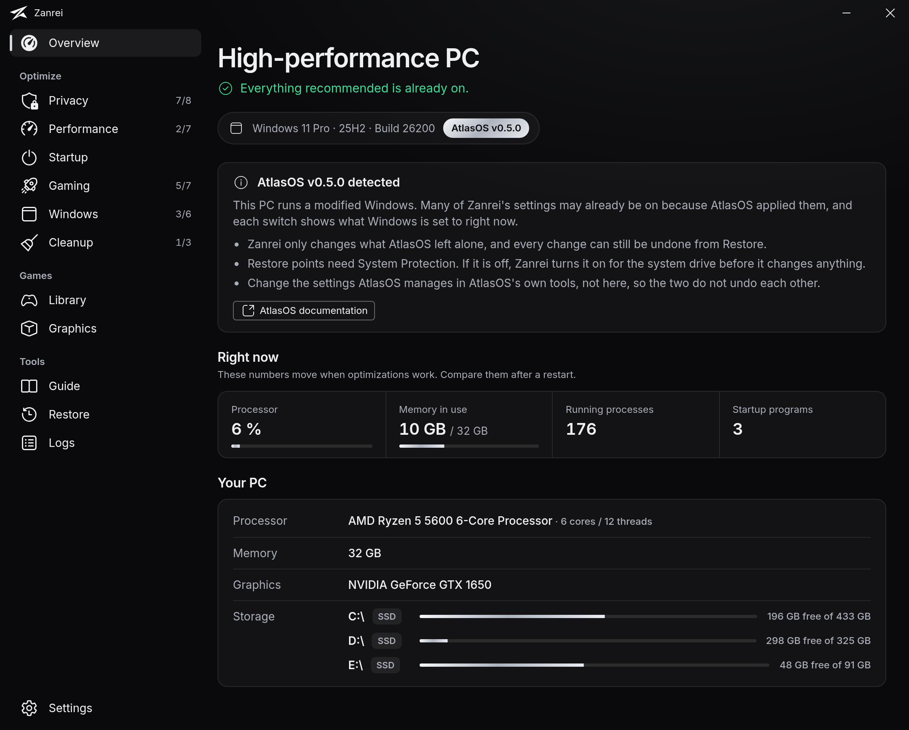
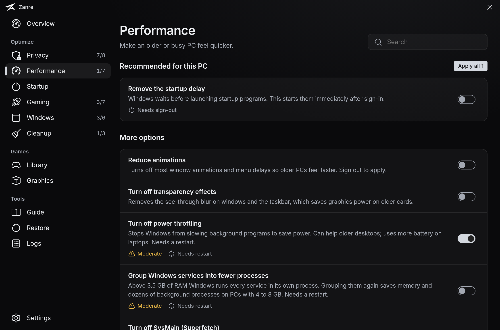
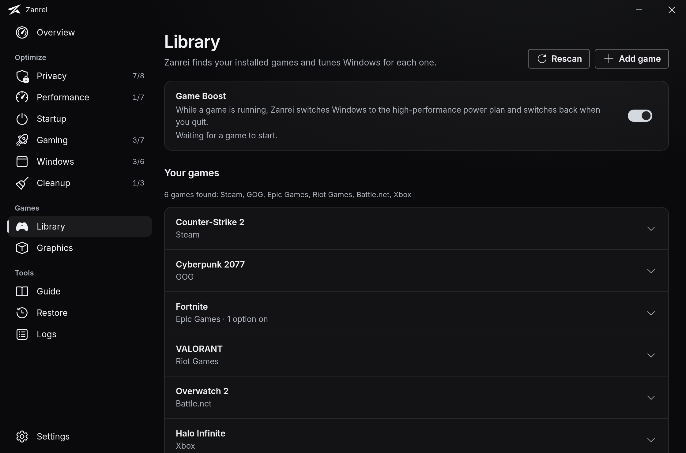
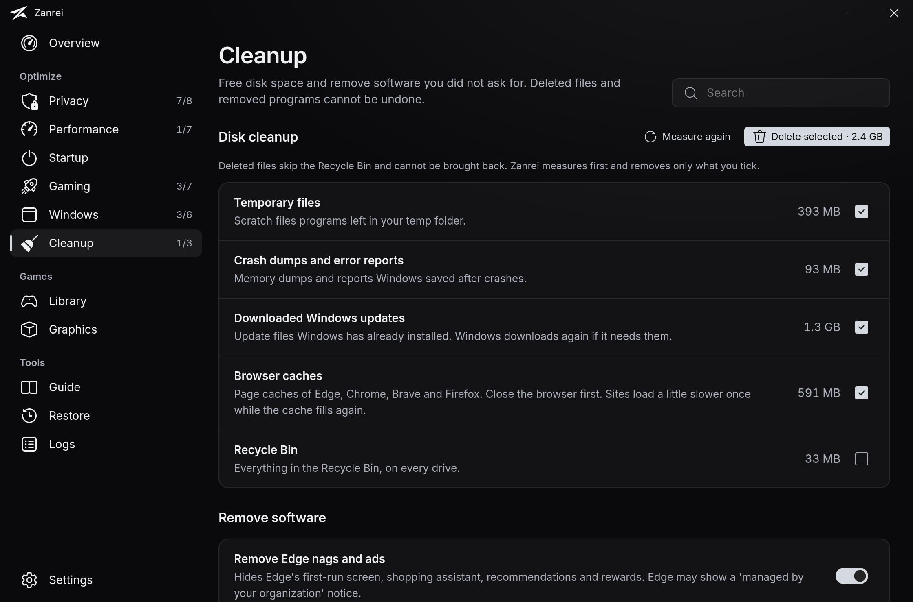
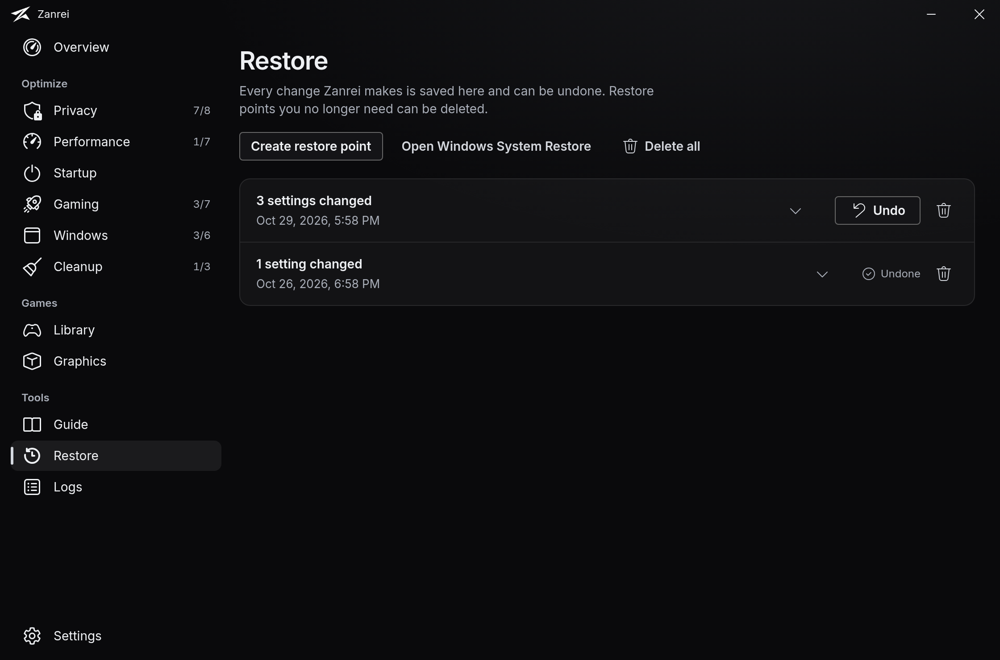

<div align="center">


# Zanrei

**Windows optimization where every change can be undone.**

[](https://github.com/sleax-dev/zanrei/actions/workflows/release.yml)
[](https://github.com/sleax-dev/zanrei/releases/latest)


[Download](https://github.com/sleax-dev/zanrei/releases/latest) · [Changelog](CHANGELOG.md) · [How the settings were chosen](docs/OPTIMIZATION-RESEARCH.md)



</div>

Zanrei reads your PC's hardware, suggests what is worth changing, and creates a restore point before it touches anything. Each change is journaled, so you can undo a whole session or a single setting from inside the app.

> Zanrei is young. Read what a setting does before you switch it on, and keep its restore points until you trust it.

## What it does

- **About 45 settings in plain language.** Privacy, performance, gaming, interface, system and cleanup, each with a risk level (safe, moderate, advanced). A switch always shows what Windows is set to right now, whoever changed it.
- **Startup manager.** Turn entries from the Run keys and Startup folders off and on without uninstalling anything.
- **Games.** Finds games from Steam, Epic, GOG, Ubisoft Connect, the EA app, Xbox, Battle.net, Riot, Rockstar and Bethesda by reading their own records. Per game: high-performance GPU, no fullscreen optimizations, higher CPU priority.
- **Game Boost.** Switches to the high-performance power plan while a game runs and restores yours afterwards.
- **Disk cleanup.** Measures first, deletes only what you tick.
- **Restore.** Undo any snapshot, delete old ones, or open Windows System Restore.
- **Guide.** The steps no app can do for you (BIOS memory profile, Resizable BAR, drivers, hardware) and how to reinstall Windows cleanly.
- **Knows your Windows.** Recognizes AtlasOS and ReviOS and adjusts its advice.
- **Updates itself** from signed releases. Ten languages. No account, no telemetry.

<table>
  <tr>
    <td></td>
    <td></td>
  </tr>
  <tr>
    <td></td>
    <td></td>
  </tr>
</table>

## Install

1. Download `Zanrei_<version>_x86-setup.exe` from [Releases](https://github.com/sleax-dev/zanrei/releases/latest). The one installer covers 32-bit and 64-bit Windows.
2. Run it. Zanrei needs administrator rights and installs WebView2 if it is missing.
3. Follow the three-step setup.

The installer is not code-signed yet, so SmartScreen may warn about an unknown publisher: choose **More info → Run anyway**. Updates are signed and verified inside the app.

Requires Windows 10 or 11.

## How it keeps you safe

- **No restore point, no change.** If one cannot be created, Zanrei stops.
- **Everything is journaled.** Registry values, scheduled tasks and commands are recorded before they change; undo puts back what existed and removes what Zanrei added.
- **Irreversible actions say so.** Removing Edge, removing built-in apps, disk cleanup and deleting restore points are marked, never run as part of "apply all" or automatic mode, and the first two ask for an explicit acknowledgement.
- **Three automation levels.** Manual, Recommended (default) and Automatic. Automatic only applies safe settings and never anything you switched off by hand.

Zanrei contacts the internet only to check for updates on GitHub, to download WebView2 if needed, and when you open a link.

## Build from source

```powershell
npm install
npm run tauri dev
```

Requirements and the full workflow are in [CONTRIBUTING.md](CONTRIBUTING.md). To report a vulnerability, see [SECURITY.md](SECURITY.md).

## Credits

Registry values and the removable-apps list were cross-checked against [winutil](https://github.com/ChrisTitusTech/winutil), [Win11Debloat](https://github.com/Raphire/Win11Debloat) and [Windows10Debloater](https://github.com/Sycnex/Windows10Debloater) (all MIT). No code was copied. The interface font is [Inter](https://rsms.me/inter/) (SIL OFL).
